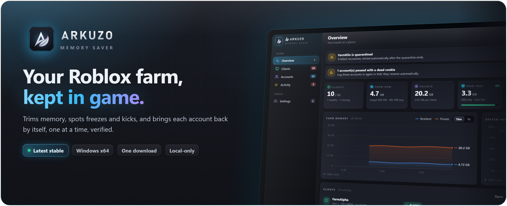
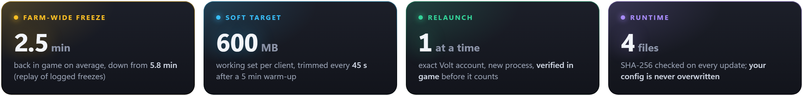
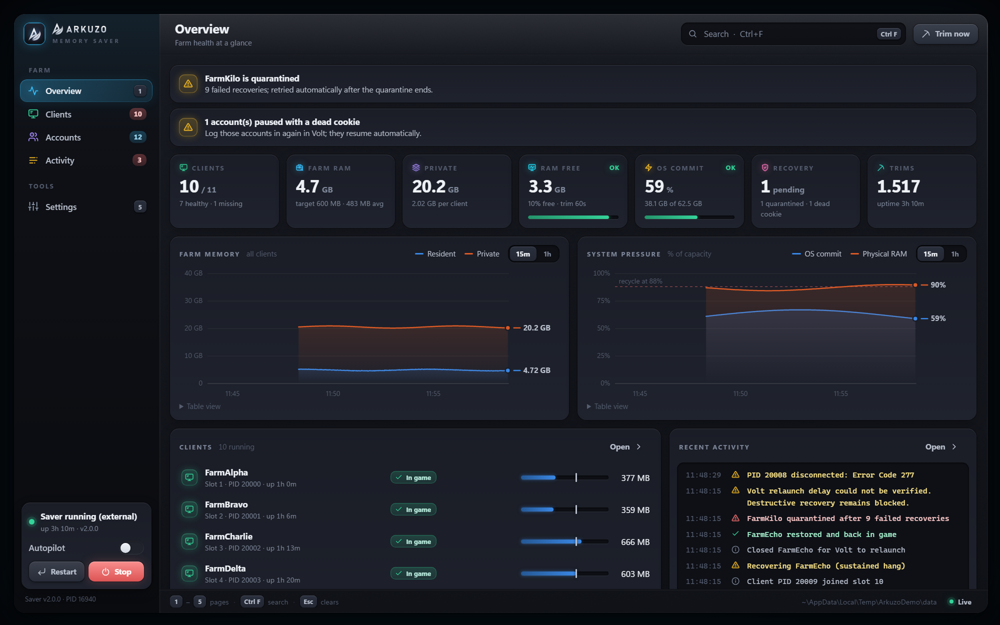
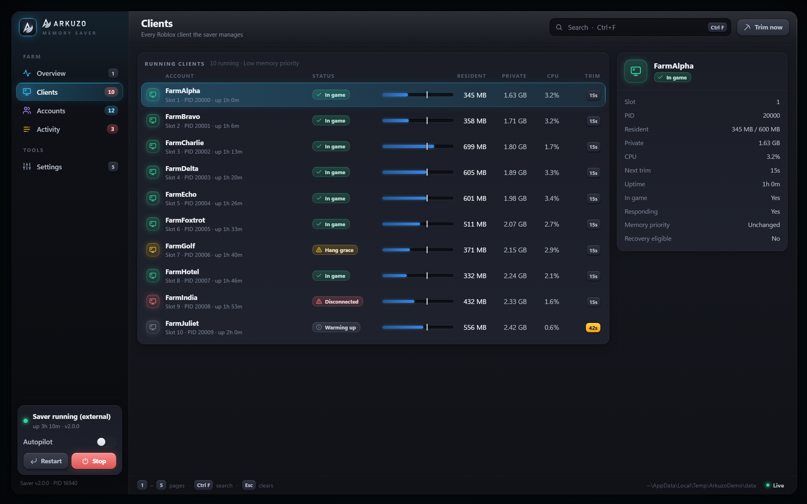
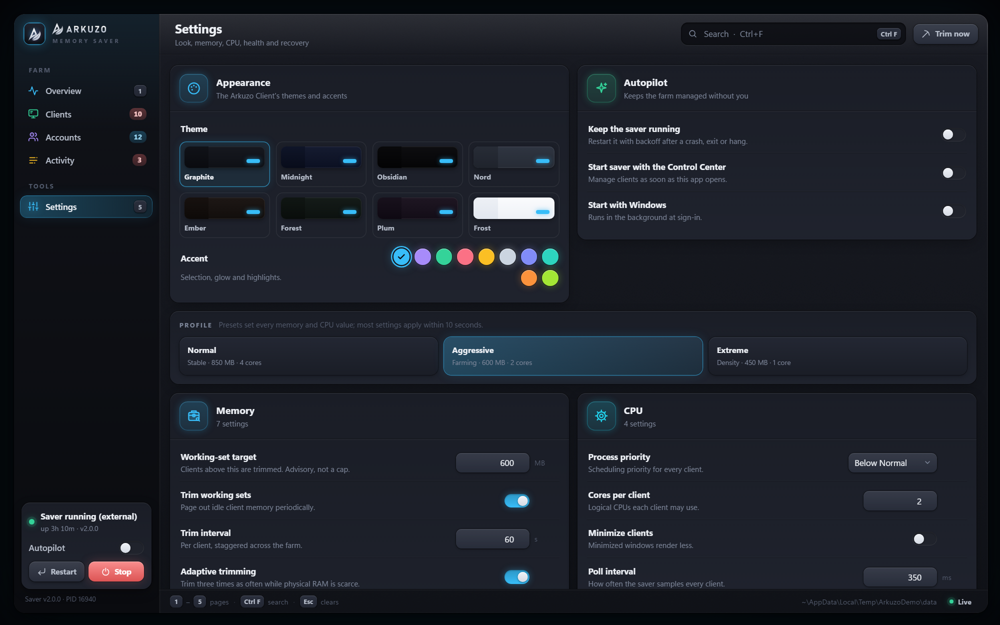
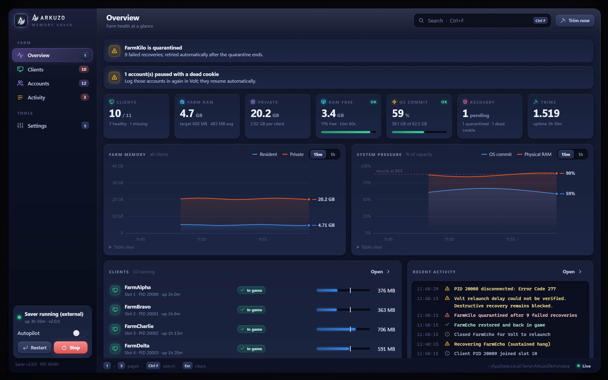
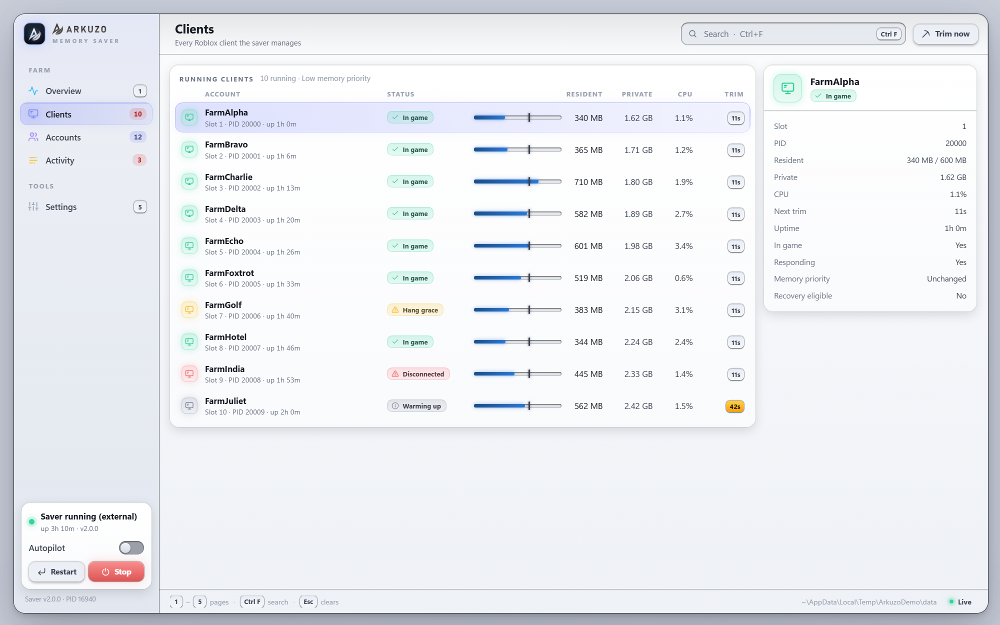
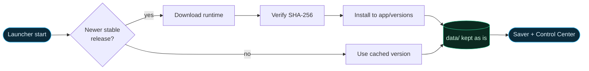
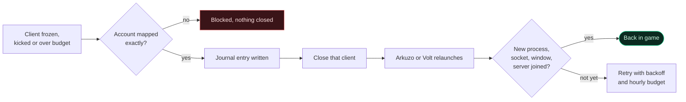
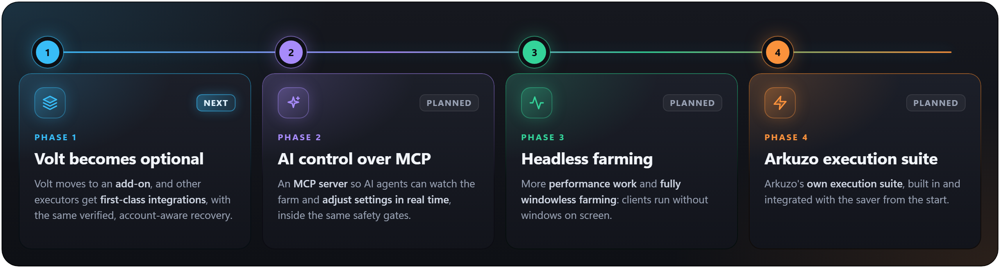

<div align="center">



<br>

[](CHANGELOG.md)
[](#requirements)
[](#requirements)
[](#recovery-is-deliberately-conservative)

### [**⬇&nbsp; Download ArkuzoMemorySaver.exe**](https://github.com/arkuzodev/arkuzo-memory-saver/releases/latest/download/ArkuzoMemorySaver.exe)

[Releases](https://github.com/arkuzodev/arkuzo-memory-saver/releases/latest) &nbsp;·&nbsp; [Configuration](docs/configuration.md) &nbsp;·&nbsp; [Troubleshooting](docs/troubleshooting.md) &nbsp;·&nbsp; [Accounts without Volt](docs/accounts.md) &nbsp;·&nbsp; [Farm-freeze recovery](docs/farm-freeze-recovery.md) &nbsp;·&nbsp; [Roadmap](#roadmap) &nbsp;·&nbsp; [Changelog](CHANGELOG.md)

</div>

<br>



<sub>The 2.5 min is the average per account when the four logged farm-wide freezes (23–27 Oct) are replayed against v2.1.5; the logs showed 5.8 min. See [farm-freeze recovery](docs/farm-freeze-recovery.md).</sub>

## What it does

<table>
<tr>
<td width="50%" valign="top">

<b>Memory you can read</b><br>
<sub>Resident working set, private memory and OS commit pressure, tracked separately per client and for the whole farm.</sub>
</td>
<td width="50%" valign="top">

<b>Careful working-set trimming</b><br>
<sub>600 MB soft target, a 5-minute warm-up per client and a 45 s trim interval. Loading, frozen and startup-error clients are skipped.</sub>
</td>
</tr>
<tr>
<td valign="top">

<b>Freeze, hang and kick recovery</b><br>
<sub>A farm-wide freeze is confirmed after 35 s and the frozen clients are closed one every 20 s, so Volt relaunches them cleanly. Kicked and frozen clients that quit on their own are queued too.</sub>
</td>
<td valign="top">

<b>Own account manager</b><br>
<sub>Add accounts by cookie or browser sign-in, check whether each is still signed in, start the farm and relaunch every client yourself, with no Volt needed. A relaunch counts once the new client is in game.</sub>
</td>
</tr>
<tr>
<td valign="top">

<b>Cookie-dead isolation</b><br>
<sub>Dead sessions show in a red <code>COOKIE DEAD</code> section. Only that account pauses, and only when it is verified idle.</sub>
</td>
<td valign="top">

<b>Portable, verified updates</b><br>
<sub>Versioned runtime in <code>app/</code>, your config, logs and journal in <code>data/</code>. Every download is SHA-256 checked; cached versions start offline.</sub>
</td>
</tr>
<tr>
<td valign="top">

<b>Arkuzo Control Center</b><br>
<sub>A local dashboard on <code>127.0.0.1</code>: every client, farm memory and system pressure charts, your accounts and farm start, an activity feed and live settings.</sub>
</td>
<td valign="top">

<b>Autopilot</b><br>
<sub>Keeps the saver alive: restarts it with backoff after a crash, exit or hang, and pauses instead of looping if it keeps crashing.</sub>
</td>
</tr>
</table>

> [!NOTE]
> **600 MB is a soft target, not a hard cap.** Trimming lowers resident RAM for a while; it doesn't free private allocations or fix a leak. The 82% OS commit threshold picks recovery candidates; it is not a promise against crashes.

## The Control Center

The launcher opens it for you (it needs Python 3 on `PATH`); in a source checkout, `Arkuzo-Control-Center.cmd` does the same. It follows the Arkuzo Client's look: eight themes, ten accents, card surfaces, keycaps and the boot intro.



<table>
<tr>
<td width="50%"><p align="center"><sub><b>Clients</b></sub></p></td>
<td width="50%"><p align="center"><sub><b>Settings</b></sub></p></td>
</tr>
<tr>
<td><p align="center"><sub><b>Midnight · Violet</b></sub></p></td>
<td><p align="center"><sub><b>Frost · Indigo</b></sub></p></td>
</tr>
</table>

<sub>Pictures use a synthetic demo farm, not real accounts or measurements.</sub>

- **Close the window and it exits cleanly:** the saver stops and the Control Center quits, like **Settings → Stop farm & quit**. Your Roblox clients keep running.
- **Updates take over by themselves:** starting the launcher always runs the newest installed version. A newer Control Center replaces an older running one and restarts the saver on the new version if it was running.
- **Start with Windows** is optional. A launcher install opens the window at sign-in; a source checkout starts in the background until you open its window and close it.

## Get started

| | |
| :---: | :--- |
| <kbd>1</kbd> | **Download** [`ArkuzoMemorySaver.exe`](https://github.com/arkuzodev/arkuzo-memory-saver/releases/latest/download/ArkuzoMemorySaver.exe) into its own writable folder, not a temporary download preview. |
| <kbd>2</kbd> | **Run it.** The first start downloads the latest stable runtime, checks its SHA-256 and installs it. |
| <kbd>3</kbd> | **Add your accounts** on the Control Center's Accounts page (cookie or browser sign-in), set the place, and press **Start farm**. Using Volt's account manager instead works too. |
| <kbd>4</kbd> | **Tune** `data/config.json` with the [configuration guide](docs/configuration.md), or use the Control Center's Settings page. |
| <kbd>5</kbd> | **Give each new client its five-minute warm-up** before expecting regular trimming. |

Monitoring and trimming work without Python or Volt. Without them, recovery stays off: the saver never closes a client it can't bring back.



> [!IMPORTANT]
> The first start needs internet access. Later starts work offline from a validated cached runtime. **An update never overwrites your configuration;** if `data/config.json` is malformed, the saver refuses to start instead of replacing it with defaults.

## Recovery is deliberately conservative

The launcher is either Arkuzo's own account manager ([accounts without Volt](docs/accounts.md)) or Volt's. Arkuzo keeps the cookies you add encrypted for your Windows user and sends them only to Roblox. With Volt, the saver never writes Volt's database: it reads state and uses verified Account Manager controls. Either way, an accepted launch request is not treated as a restored session.



- **Only opted-in, uniquely mapped accounts.** Unknown mappings, loading screens, unavailable logging or an unhealthy journal block every destructive step. Arkuzo maps each client by the account's own tracker id on its command line; clients it didn't launch are left alone.
- **Arkuzo relaunches by itself** after the relaunch delay (8 s), launches spaced 12 s apart, and retries only a launch that produced no client.
- **With Volt, its relaunch delay stays at 30 s or more;** a larger delay you set is kept. Missing-account retries back off for 90–900 s, with cooldowns and hourly budgets that survive saver restarts.
- **A restore must prove itself:** a new, exactly mapped process, a connected launcher socket, a responsive window without errors and matching server-join evidence, held for a continuous confirmation window.
- **Farm-wide freezes** (in the logs, Chrome Remote Desktop disconnects and display events) are handled as one event, with closes paced so Volt doesn't show its "Roblox started before Volt could connect" notice. Switch it off with `health.farm_freeze_enabled`.

<details>
<summary><b>Cookie-dead accounts</b></summary>
<br>

Volt's red cross means a dead account session. The saver shows these accounts in red as **`COOKIE DEAD`**. A dead session can come from expiry, revocation, a challenge or another sign-in problem; it is not proof of a ban.

A verified idle dead account is paused and left out of launch requests. Its recovery history is kept separately so it doesn't hold the handoff gate for healthy accounts. If a process, launch or identity is uncertain, the gate stays closed. Restore the session in Volt yourself; the saver resumes once the account checks out again. Newly imported accounts with no launch history are shown but never activated automatically.

</details>

<details>
<summary><b>What it does not promise</b></summary>
<br>

- No guaranteed RAM ceiling, leak repair, crash-free operation or uninterrupted game session.
- No guaranteed fix for Volt launch guards, seat limits, seat-lease expiry or sign-in failures.
- No assumption that zero CPU, a live process or Volt's "Connected" label alone proves a client is healthy.
- No bypass of account opt-in, singleton protection, identity checks or retry budgets.

The readiness checks above are criteria for counting a restore, not an overnight endurance guarantee.

</details>

## Requirements

| | |
| :--- | :--- |
| **System** | Windows x64 with Windows PowerShell 5.1. No separate .NET install; the launcher is self-contained. |
| **Folder** | A writable folder for `ArkuzoMemorySaver.exe`, `app/` and `data/`. |
| **Network** | Internet for the first runtime download and update checks. |
| **Accounts** | Arkuzo accounts need nothing extra (browser sign-in uses Edge or Chrome). With Volt instead: Python 3 on `PATH` and a running Volt with Account Manager reachable. |

<details>
<summary><b>Upgrading a legacy installation</b></summary>
<br>

If `data/config.json` doesn't exist and a `config.json` sits beside `ArkuzoMemorySaver.exe`, the launcher copies it byte for byte into `data/` and keeps the original. An existing `data/config.json` always wins. Old recovery journals are not migrated. Stop the old saver before switching installations.

</details>

## Roadmap



| Phase | Goal | What it means |
| :---: | :--- | :--- |
| <kbd>1</kbd> **Next** | **Volt becomes optional** | Volt moves to an add-on, and other executors get first-class integrations, with the same verified, account-aware recovery. |
| <kbd>2</kbd> | **AI control over MCP** | An MCP server so AI agents can watch the farm and adjust settings in real time, inside the same safety gates. |
| <kbd>3</kbd> | **Headless farming** | More performance work and fully windowless farming: clients run without windows on screen. |
| <kbd>4</kbd> | **Arkuzo execution suite** | Arkuzo's own execution suite, built in and integrated with the saver from the start. |

<sub>Plans, not promises: order and scope can change. Shipped work lands in the <a href="CHANGELOG.md">changelog</a>.</sub>

## Integrity and antivirus

v2.1.5 ships a rebuilt executable and new archives; all 1.x releases are deprecated. VirusTotal results for these files are not recorded yet, so compare the checksums with the release before running anything.

| File | SHA-256 | VirusTotal |
| :--- | :--- | :--- |
| **`ArkuzoMemorySaver.exe`** | `daa38b0e83788c9519fac2de6fd440737c3f3fdead07f5f504640b58c0b7f4a1` | Not yet scanned |
| **`ArkuzoMemorySaver-runtime.zip`** | `5ae228a1bbd7b38943b6745f29c11f73dd2b2ec1c0cfce204a81b98501c10f30` | Not yet scanned |
| **`ArkuzoMemorySaver-controlcenter.zip`** | `f3bb2f3874a3220492ab2766835071d600005da8ba3f95b28a1eae1c587d9d47` | Not yet scanned |
| **`ArkuzoMemorySaver-v2.1.5-win-x64.zip`** | `7f32df4793312cb886bbe4bb421bf4f33a0265efaad4114acc58defe199b5fa3` | Not yet scanned |

Each release also publishes **`SHA256SUMS.txt`**, plus **`ArkuzoMemorySaver-runtime.sha256`** and **`ArkuzoMemorySaver-controlcenter.sha256`** for the updater. The launcher checks downloaded bytes and GitHub's asset digests. A checksum detects a mismatch; it is not a code signature. See [security and privacy](SECURITY.md).

```powershell
Get-FileHash -Algorithm SHA256 .\ArkuzoMemorySaver.exe
```

> [!WARNING]
> Windows may show a SmartScreen warning for this **unsigned** executable. Check that it came from this repository and follow your organization's policy. **Don't turn off SmartScreen, antivirus or other protections globally.**

<details>
<summary><b>For maintainers</b></summary>
<br>

End users need only the root `ArkuzoMemorySaver.exe`, not a source checkout or a hand-assembled runtime.

| Source | Purpose |
| :--- | :--- |
| `src/launcher/` | Self-contained launcher, update and cache handling. |
| `src/saver/` | Saver engine, Volt control adapter, read-only Python probe and the Control Center. |
| `config/defaults.json` | Packaged defaults for a new user configuration. |
| `tests/` | Regression, safety, updater and portability tests (`build/test.ps1`). |
| `build/` | Launcher build, packaging and release verification. |

The release runtime has **exactly four files**: engine, control adapter, Python probe and `defaults.json`. Mutable user files stay outside it. Never ship live account stores, logs, recovery journals, authenticated command lines or machine-specific paths. See [releasing](docs/releasing.md).

</details>

<br>

<div align="center">
<sub>Report issues through the <a href="https://github.com/arkuzodev/arkuzo-memory-saver/issues">repository</a> with sanitized diagnostics and your installed version, never credentials or account data.</sub>
</div>
